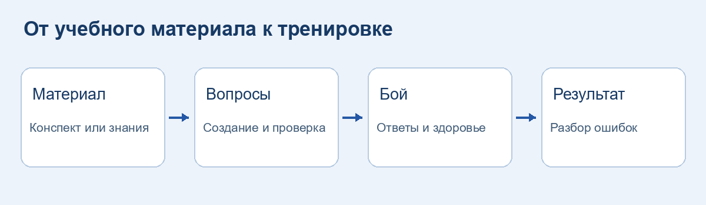

# Интеллектуальный тренажёр проверки знаний

Руководство пользователя мобильного приложения для закрепления знаний в форме игрового боя.
Подготовьте вопросы вручную или по конспекту, проверьте их и начните тренировку.

## С чего начать

1. [Зарегистрируйтесь или войдите](/guide/account/).
2. [Подготовьте набор вопросов](/guide/questions/).
3. [Настройте и пройдите бой](/guide/game/).
4. [Посмотрите результаты](/guide/results/).

## Разделы справки

- [Начало работы](/guide/)
- [Учётная запись](/guide/account/)
- [Наборы и доступ по ключу](/guide/questions/)
- [Ручное создание вопросов](/guide/questions/manual/)
- [Генерация по конспекту](/guide/questions/generation/)
- [Игровой бой](/guide/game/)
- [История и работа над ошибками](/guide/results/)
- [Пример тренировки](/guide/example/)

Если справка не загружается в приложении, проверьте подключение к сети и нажмите «Повторить».

## Поддержка и персональные данные

Разработчик: Хмеляр Екатерина Игоревна. По вопросам работы приложения, помощи, исправления или удаления данных и аккаунта напишите на katerinaxmelar2402@gmail.com. Обращения рассматривает разработчик лично. Не отправляйте пароли и одноразовые коды.

- [Политика конфиденциальности](/legal/privacy/)
- [Согласие на обработку данных](/legal/consent/)
