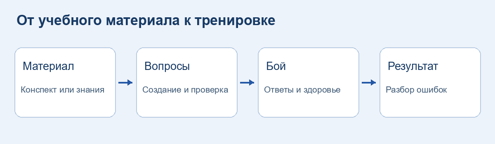

# Пример тренировки

Посмотрим, как подготовить короткую тренировку по устройству компьютера.

## Главное правило

<u>В каждом вопросе должен быть ровно один правильный ответ.</u>

## Пример содержимого вопроса

Ниже показан условный вопрос в формате JSON. Это пример структуры данных, а не инструкция по импорту файла в приложение.

```json
{
  "question": "Какой компонент выполняет вычисления?",
  "answers": [
    { "text": "Процессор", "isCorrect": true },
    { "text": "Монитор", "isCorrect": false },
    { "text": "Клавиатура", "isCorrect": false }
  ]
}
```

## Последовательность действий



Внесите вопрос через [редактор вопросов](/guide/questions/manual/), сохраните набор и выберите его для боя.

## Перейти к правилам боя

Нажмите на изображение, чтобы открыть инструкцию по игровому бою.

[](/guide/game/)

[На главную страницу справки](/)
